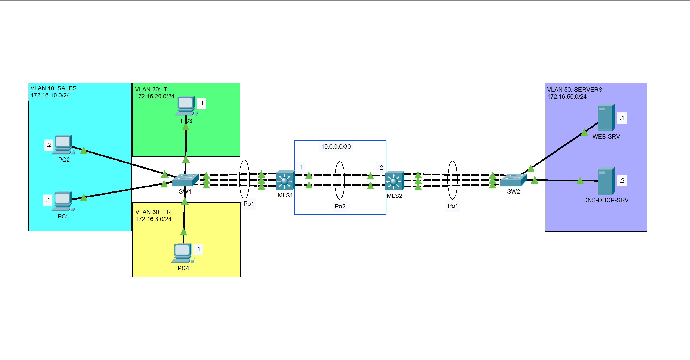

# EtherChannel – Link Aggregation with PAgP, LACP and Static Mode

## Overview

This project demonstrates the implementation of **EtherChannel technology** in a switched network environment using Cisco Packet Tracer.

The lab explores three EtherChannel configuration methods:

- **PAgP (Port Aggregation Protocol):** Cisco proprietary negotiation protocol.
- **LACP (Link Aggregation Control Protocol):** IEEE 802.1AX standard negotiation protocol.
- **Static EtherChannel:** Manual link aggregation without negotiation.

The network also integrates VLAN segmentation, Layer 2 trunking, Layer 3 switching, inter-VLAN routing, DHCP relay, and static routing.

The objective is to understand how multiple physical interfaces can be bundled into a single logical interface to increase available bandwidth, provide link redundancy, and simplify network management.

## Network Topology



The topology consists of four Cisco switches:

- **MLS1:** Multilayer switch providing inter-VLAN routing for user networks.
- **MLS2:** Multilayer switch providing connectivity to the server network.
- **SW1:** Access switch serving the SALES, IT, and HR VLANs.
- **SW2:** Access switch serving the SERVERS VLAN.

Three EtherChannel connections are implemented between these devices.

## EtherChannel Implementation

| Connection | Physical Interfaces | Protocol | Configuration Mode | Layer |
|---|---|---|---|---|
| SW1 – MLS1 | Fa0/22-24 | PAgP | Desirable | Layer 2 |
| SW2 – MLS2 | Fa0/22-24 | LACP | Active | Layer 2 |
| MLS1 – MLS2 | Gi0/1-2 | Static (`on`) | Manual | Layer 3 |

### 1. PAgP EtherChannel

A three-link EtherChannel is configured between SW1 and MLS1 using PAgP in desirable mode.

The resulting Port-Channel operates as an 802.1Q trunk carrying VLANs 10, 20, and 30.

### 2. LACP EtherChannel

A three-link EtherChannel is configured between SW2 and MLS2 using LACP in active mode.

The resulting Port-Channel operates as a trunk carrying VLAN 50 (SERVERS).

### 3. Layer 3 Static EtherChannel

A two-link Layer 3 EtherChannel is configured between MLS1 and MLS2.

Both switches use static EtherChannel mode (`on`), with the following IP addressing:

| Device | Interface | IP Address |
|---|---|---|
| MLS1 | Port-channel2 | 10.0.0.1/30 |
| MLS2 | Port-channel2 | 10.0.0.2/30 |

Static routes are configured to provide connectivity between the user VLANs and the server network.

## VLAN and IP Addressing

| VLAN | Name | Network | Default Gateway |
|---|---|---|---|
| 10 | SALES | 172.16.10.0/24 | 172.16.10.254 |
| 20 | IT | 172.16.20.0/24 | 172.16.20.254 |
| 30 | HR | 172.16.30.0/24 | 172.16.30.254 |
| 50 | SERVERS | 172.16.50.0/24 | 172.16.50.254 |

Additional network configurations include:

- Inter-VLAN routing using SVIs.
- DHCP relay using `ip helper-address`.
- Static routing between multilayer switches.
- EtherChannel load balancing using `src-dst-ip`.
- 802.1Q trunking with native VLAN 1001.

## Verification and Testing

The implementation was validated using Cisco IOS verification commands and end-to-end connectivity tests.

| Verification | Command |
|---|---|
| EtherChannel status | `show etherchannel summary` |
| Trunk configuration | `show interfaces trunk` |
| VLAN information | `show vlan brief` |
| Interface status | `show ip interface brief` |
| Routing table | `show ip route` |

### Test Results

The following tests were performed:

- Verification of PAgP negotiation and aggregation.
- Verification of LACP negotiation and aggregation.
- Verification of static Layer 3 EtherChannel operation.
- Verification of trunk links and VLAN propagation.
- Verification of DHCP functionality.
- Verification of DNS resolution.
- Verification of HTTP service accessibility.
- End-to-end connectivity testing between network segments.

Screenshots and command outputs are available in the `tests/` directory.

## Repository Structure

```text
Ether_Channel/
│
├── configs/
│   ├── MLS1-config.txt
│   ├── MLS2-config.txt
│   ├── SW1-config.txt
│   └── SW2-config.txt
│
├── docs/
│   ├── documentation.md
│   └── topology.png
│
├── src/
│   └── Ether_Channel.pkt
│
├── tests/
│   ├── dhcp-test.png
│   ├── dns-test.png
│   ├── end-to-end-connectivity.png
│   ├── http-test.png
│   ├── shows.txt
│   └── simulation-mode.png
│
├── .gitignore
├── LICENSE
└── README.md
```

## How to Use

1. Clone this repository:

   ```bash
   git clone https://github.com/Victorin13/Ether_Channel.git
   ```

2. Open `src/Ether_Channel.pkt` using Cisco Packet Tracer.

3. Explore the network topology and device configurations.

4. Review the configuration files in `configs/`.

5. Consult `tests/` to examine the verification commands and test results.

## Technologies and Concepts

- Cisco Packet Tracer
- Cisco IOS
- EtherChannel
- PAgP
- LACP
- Static Link Aggregation
- VLANs and 802.1Q Trunking
- Layer 2 and Layer 3 Switching
- Inter-VLAN Routing
- DHCP Relay
- Static Routing
- Network Load Balancing

## Author

**C. Victorin Vodinou**

Networking | Systems Administration | Network Security

[GitHub Profile](https://github.com/Victorin13)
[LinkedIn Profile](https://www.linkedin.com/in/victorin-vodinou/)
Gmail Prifile: victorinvodinou@gmail.com

This project is part of my hands-on networking lab portfolio.

## License

This project is distributed under the MIT License. See [](LICENSE) for details.
